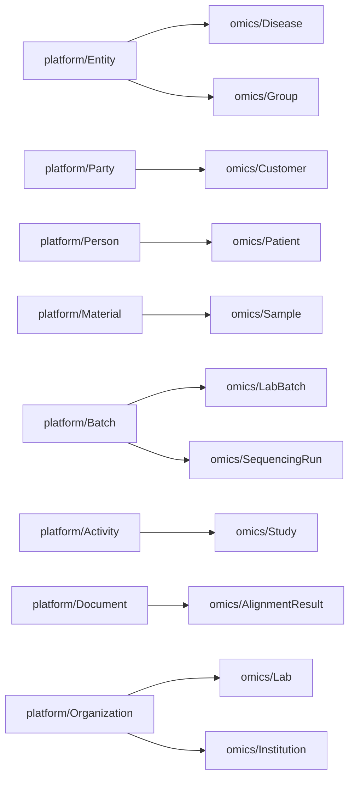

# Module 1: From GoliathApp to GoliathOmics

*Genomics with GoliathOmics · Goliath Research Academy* · [Course syllabus](../README.md)

**Lab:** the disposable PostgreSQL 19 lab (`python course_lab.py up`) ·
**Sources:** GoliathOmics `docs/architecture/dependencies.md`, `docs/goliathapp-extension.md`,
`database/schema/15_omics_meta_domain_classes.sql`, `src/goliath_omics/seed/*`

## Goal

See exactly what a child application adds to GoliathApp, and what it does not. By the end you can
list every `omics/*` class with its `platform/*` parent, name the actions each class owns, and
explain why GoliathApp contains no genomics code at all.

## 1.1 The rule: GoliathApp knows nothing about Omics

GoliathApp is the platform: Meta classes and objects, actions as class methods, the semantic
layer, NavTree and RBAC, the `wf` workflow engine, workers, `cfg` documents and the portal.
GoliathOmics is a **descendant application**. It specializes the platform through the
platform's own mechanisms:

| GoliathOmics adds | Through which GoliathApp mechanism | Where |
|---|---|---|
| Vocabulary: `omics/Patient`, `omics/Sample`, … | Meta subclasses of `platform/*` classes | `database/schema/15_omics_meta_domain_classes.sql` |
| Behavior: `sample.*`, `pipeline.*`, `validation.*`, `context.*` actions | Typed ActionSpec catalog, bound as **methods of exactly one owning class** | `schemas/actions/catalog.json`, `src/goliath_omics/seed/meta_action_methods.py` |
| Clinical reads and writes | Semantic requests in the `omics` namespace | `src/goliath_omics/semantic/catalog.py` |
| Screens | NavTree nodes under `/app/omics` that open GoliathApp's generic frames | `database/schema/16_omics_portal_host_nav.sql` |
| Configuration types | Typed `cfg` document types edited in GoliathApp's typed grid | `src/goliath_omics/seed/config_document_types.py` |
| Science | Workers that claim `wf` tasks | `workers/methyl_worker/` |

Nothing flows the other way. If a new assay is added tomorrow, no GoliathApp table, function or
screen changes. That is the property David's platform depends on: *any customer can change the
technology* and the platform stays the same.

Two operating rules carried through the whole course:

* **No JSON is typed or pasted into the platform.** Configuration is edited as typed Meta
  documents in the typed grid; actions are invoked as class methods with typed parameters.
* **Everything is a Meta class or object.** Even a configuration document, a NavTree node or a
  permission has a Meta identity.

## 1.2 The `omics/*` classes



Expected in the lab: **11** `omics/*` classes. `omics/SequencingRun` and `omics/AlignmentResult`
are filled from the execution record. Each successful FASTQ ingest step (`sample.download_fastq`)
records one `omics/SequencingRun`. Each successful alignment step records one
`omics/AlignmentResult` that links to its run, sample, study and BAM. The writers are class methods
on those two classes (GoliathOmics #119; Module 9).

## Lab sequence

Start the lab once (it takes a few minutes the first time, mostly downloads):

```bash
python course_lab.py init      # writes .env with random local-only values
python course_lab.py up        # PostgreSQL 19 + official GoliathApp/GoliathOmics apply and seeds
python course_lab.py status    # prints the lab checks; all must pass
```

`status` should print, among others: `omics classes 11`, `workflow actions 73`,
`workflow definitions 7`, `published analytes 5`, `assay procedures 8`, `public patients 1`.

Then open `python course_lab.py psql` and run:

1. The class tree:

   ```sql
   SELECT c."Name" AS class, p."Name" AS parent
   FROM "Meta"."Classes" c JOIN "Meta"."Classes" p ON p."ID" = c."ParentID"
   WHERE c."Name" LIKE 'omics/%' ORDER BY 1;
   ```

   Expect 11 rows matching the diagram.

2. The action catalog by namespace:

   ```sql
   SELECT split_part(action_name, '.', 1) AS namespace, count(*)
   FROM wf.workflow_action GROUP BY 1 ORDER BY 2 DESC;
   ```

   Expect `sample 28`, `pipeline 18`, `validation 13`, `workflow 10`, `inv 3`, `context 1`
   (73 in total). `workflow.*` and `inv.*` are GoliathApp's; the rest are GoliathOmics'.

3. The semantic requests GoliathOmics registers and the permission each one needs:

   ```sql
   SELECT request_code, required_permission FROM portal.semantic_request
   WHERE request_code LIKE 'omics.%' ORDER BY 1;
   ```

## Practice

* Which `platform/*` class would a new modality's "specimen" extend? Which GoliathApp table
  would you change? (Answer: `platform/Material`; none.)
* Find the owning class of `sample.methyl_extract` and of `pipeline.rna_de_select` in
  `meta_action_methods.py`. Why must an action have exactly one owner?

## Evidence to submit

* The three query results above.
* A one-paragraph answer: "What would change in GoliathApp if GoliathOmics added a fourth
  modality?"

## Handoff to Module 2

You have the vocabulary. Module 2 fills it with the one public sample the whole course follows.
