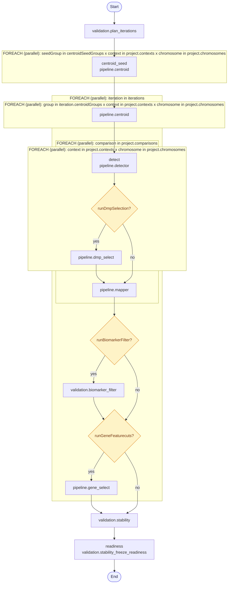
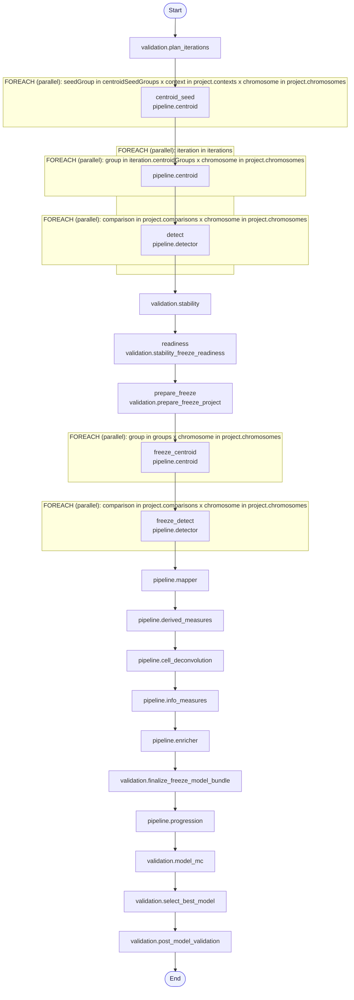

# Module 10: Studies, Partitions & the Claim Gate

*Genomics with GoliathOmics · Goliath Research Academy* · [Course syllabus](../README.md)

**Notebook (optional):** `10_holdout_leakage.py` ·
**Sources:** GoliathOmics `docs/usage/18-samd-study-lifecycle.md`, `docs/usage/15-optional-hyperparameter-search.md`,
`packages/methylvalidation/methyl_validation/config.py` (`RegulatoryLifecycleConfig`),
`workflow_engine/domain/profiles/samd_*.profile.json`, `docs/regulatory/samd-submission-scaffold.md`,
`docs/usage/21-…`, `23-…`, `25-prostate-cancer-pack.md`

## Goal

A diagnostic claim needs development data kept strictly apart from locked test data, with settings
frozen before the claim is tested. Learn how GoliathOmics enforces that in code for every modality,
and separate **analytical validity** (does the assay measure the analyte correctly?) from
**clinical validity** (does the result track the condition?).

## 10.1 The study manifest and the profile ladder

| Layer | Owns | Rule |
|---|---|---|
| Study manifest `project_*.json` | cohorts, stages, `validation_partitions`, `regulatory` | who is train vs holdout; claim stage |
| Profile `samd_*` | iterations, balanced-accuracy gates, caps | how hard the science gates are |
| DomainProgram | topology (Monte Carlo → stability → freeze → model) | what runs |
| Site | cluster caps, references | deployment bounds |

| Profile | Default `regulatory.stage` | Holdouts | Hyperparameters |
|---|---|---|---|
| `samd_research` | `expanded_development` | `locked_test` recommended | exploratory; search allowed |
| `samd_holdout_enrichment` | `internal_validation` | non-empty `locked_test` **required**, excluded from training | locked from research |
| `samd_pivotal` | `pivotal_validation` | non-empty `pivotal_validation` **required**, never used in training | fully locked; hard fail |

The same ladder applies to RNA-seq and proteomics studies (`rnaseq_research`,
`proteomics_research` at the research rung); only the feature science differs.

Compare the two core study topologies visually from their generated Mermaid diagrams (all study and
SaMD lifecycle variants are in [`diagrams/`](../diagrams/README.md) and the published
[Study and SaMD lifecycles catalog](https://goliath-research.github.io/GoliathOmics/workflows/study-lifecycles/)):

#### Research / Holdout-Enrichment topology (`SaMD_Research` — `diagrams/samd_research.mmd`)

#### Full Study Validation & Pivotal topology (`StudyValidationLifecycle` — `diagrams/study_validation_lifecycle.mmd`)

Additional modality and assay lifecycle diagrams live in `diagrams/` (`study_validation_lifecycle_no_deconv.mmd`,
`study_validation_lifecycle_residual.mmd`, `study_validation_mhl_survival.mmd`,
`plant_stress_study_lifecycle.mmd`, `rnaseq_study_lifecycle.mmd`, `proteomics_study_lifecycle.mmd`,
and `samd_pivotal.mmd`).

## 10.2 The claim gate is code

`RegulatoryLifecycleConfig` accepts stages `feasibility`, `expanded_development`,
`internal_validation`, `model_freeze`, `pivotal_validation`, `fda_submission`, `post_market`.
`allow_clinical_performance_claims: true` raises a validation error at any stage before
`pivotal_validation`. Tool knobs in the manifest (`step_config`) are rejected. Patients in
`locked_test` / `pivotal_validation` must never return to training.

## 10.3 Application packs are studies

Alzheimer cfDNA (Control → MCI → AD), plant abiotic stress (Control vs drought) and the prostate
options catalog are study configurations on existing procedures (Module 3). Their committed
examples use synthetic sample IDs. The prostate pack's registered evidence packages
(`EV-PCA-PLASMA-2026-06`, `EV-PCA-HGOOD-2026-06`, `EV-PCA-BUFFY-2026-07`) are **feasibility /
engineering** evidence and must not be cited as clinical performance.

## 10.4 Hyperparameter search without leakage

Choose the analyte and `pipelineProcedure` first, run a baseline, then sweep Tier-A `actionConfig`
knobs (mostly `validation.*`) on the same procedure. A procedure, aligner or library protocol is
never a grid axis. The winner is promoted by an operator (`portal.sp_promote_hyperparam_winner`
deep-merges dotted keys into the study `actionConfig`), and search runs and trials are recorded in
`cfg.hyperparameter_search_run` / `cfg.hyperparameter_trial`.

## Lab sequence

1. `pytest tests/test_module_10.py -v`. With the pinned source present it imports the **official**
   `RegulatoryLifecycleConfig` and shows: claims refused at `feasibility`, accepted at
   `pivotal_validation`.
2. Optional notebook: `10_holdout_leakage.py` simulates selecting features on all samples (leak)
   vs on the training split only, using pure noise. Watch accuracy on "test" data look good when
   it should be 50%.
3. In `psql`: `SELECT name FROM cfg.pipeline_profile WHERE name LIKE 'samd_%' ORDER BY 1;`
   (`samd_holdout_enrichment`, `samd_pivotal`, `samd_research`).

## Practice

* A sponsor asks you to "add the locked test patients back to improve the model". What does the
  platform do, and what would you answer?
* Why is a gene panel chosen on the whole cohort not evidence of clinical performance?

## Evidence to submit

* The pytest output and the leakage notebook's two accuracies.
* One paragraph separating analytical from clinical validity for the course's public sample.

## Handoff to Module 11

You know how the platform keeps claims honest. Module 11 explains the regulatory frameworks those
claims would be judged against.
