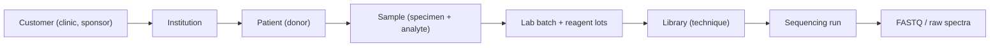

# Module 2: The Genomics Lab End to End

*Genomics with GoliathOmics · Goliath Research Academy* · [Course syllabus](../README.md)

**Lab:** PostgreSQL 19 lab and the local portal (`python course_lab.py portal`) ·
**Dataset:** ENA run `SRR28293403`, donor `HG00621` (public) ·
**Sources:** GoliathOmics `database/schema/01_portal_clinical_schema.sql`,
`docs/operators/ena-public-samples.md`, `schemas/import/ena_public_samples.json`,
`docs/operators/lab-inventory.md`, `docs/ANALYTE_PROFILES.md`

## Goal

Follow a specimen from the person it came from to the files a sequencer writes, and map every
step to a GoliathOmics entity, a configuration value, or "not modeled". You will do it with the
one sample this course uses everywhere, and you will see it in the portal.

## 2.1 Who sends what



| Step | Plain meaning | GoliathOmics today |
|---|---|---|
| Customer | Who ordered the work | `portal."Customers"` → `omics/Customer` |
| Institution | Where the patient is enrolled | `portal."Institutions"` → `omics/Institution` |
| Patient | The person (or cell line donor) | `portal."Patients"` (`ExternalID`, `InstitutionID`) → `omics/Patient` |
| Sample | One specimen and its analyte | `portal."Samples"` (`PatientID`, `CustomerID`, `DiseaseID`, `analyte_id`) → `omics/Sample` |
| Analyte | What was extracted: cfDNA, buffy coat DNA, tissue, plant tissue | `cfg.analyte` catalog (5 published) |
| Lab batch, reagent lots | Which samples were processed together, with which lots | `omics/LabBatch` (mirror only), GoliathApp `inv` lots via `13_omics_lab_inv_bridge.sql` |
| Library, technique | How the material was turned into something a sequencer or mass spectrometer reads | `libraryProtocol` on the assay procedure (Module 3) |
| Sequencing run | One instrument run | `omics/SequencingRun`, recorded from each successful FASTQ ingest step (run accession, FASTQ files, sample, study); its alignment is an `omics/AlignmentResult` (Module 9) |
| Chain of custody | Collection, receipt, storage events | **Not modeled** (gap, Module 12) |

The same chain applies to every modality. For RNA-seq the analyte is RNA and the output is
FASTQ; for proteomics the "run" is a mass-spectrometry acquisition and the output is raw spectra
or a panel matrix (Olink NPX, SomaScan RFU).

## 2.2 Public archives as a source

Archives such as ENA/SRA, BioSample and GEO hold consented, public reference data. The course uses
exactly one run:

| Item | Value | Source |
|---|---|---|
| Run | `SRR28293403`, paired-end, Illumina NovaSeq 6000, Bisulfite-Seq, 158,106,440 reads | ENA filereport |
| Sample | `WGBS-HG00621-Rep1`, BioSample `SAMN40381571`, cell line `HG00621`, "1000 Genomes LCL" | BioSample |
| Donor | `HG00621`, sex male | BioSample `SAME123082`, IGSR |
| Study | GEO `GSE261315`, BioProject `PRJNA1086543` | GEO / ENA |
| Name in the platform | `canary-SRR28293403-linear-subset` | `scripts/provision_sample_prep_canary.sh` |

Because the sample is a lymphoblastoid **cell line**, not blood drawn for a test, the lab study
declares the `combined` analyte rather than `buffy_coat`.

## 2.3 No invented facts

The importer (`scripts/import_ena_public_samples.py`) writes only what a public source states and
records the source URL of every field. Race, ethnicity and year of birth stay **empty**: no source
states them. The IGSR population ("Han Chinese South") is kept only as sample provenance; it is
not a race or an ethnicity. `CustomerID` is null because a public archive is not a customer.

This is the rule for the whole course and for production: *never fill a clinical field the
source does not state.* The lab check `lab/sql/90_verify_lab.sql` fails if the lab ever holds a
patient other than `HG00621`, any customer, or invented demographics.

## Lab sequence

1. Look at the manifest the importer used:
   `.lab-src/GoliathOmics/schemas/import/ena_public_samples.json` (inside the `lab_src` volume;
   the same file is on GitHub). Find `field_sources` for `sex` and `race`.
2. Query the archive yourself:

   ```bash
   curl -s "https://www.ebi.ac.uk/ena/portal/api/filereport?accession=SRR28293403&result=read_run&fields=sample_accession,sample_alias,read_count,instrument_model,library_strategy&format=tsv"
   ```

   Expect `SAMN40381571`, `GSM8140413`, `158106440`, `Illumina NovaSeq 6000`, `Bisulfite-Seq`.
3. In `psql`, check what landed:

   ```sql
   SELECT p."ExternalID", p."Sex", p."Race", p."Ethnicity", p."YearBorn", i."Name" AS institution
   FROM portal."Patients" p JOIN portal."Institutions" i ON i."ID" = p."InstitutionID";
   SELECT "SampleName", "CustomerID", "Extras" ? 'ena_public_provenance' AS has_provenance
   FROM portal."Samples";
   ```

   Expect one patient `HG00621 | M | NULL | NULL | NULL | ENA` and one sample with a null
   `CustomerID`.
4. Open the portal: `python course_lab.py portal`, then `python course_lab.py smoke`. The smoke
   signs in to the **local** portal as the lab operator, opens the `/app/omics` navigation, and
   runs `omics.institution.list`, `omics.patient.list` and `omics.sample.list`. Expect `ENA`,
   `HG00621`, `canary-SRR28293403-linear-subset`. Then browse `http://127.0.0.1:3400`
   (dev sign-in is printed in `HOSTED_LABS.md`).

## Practice

* Map each ENA filereport field you fetched to Institution, Patient, Sample or provenance.
* Write down which steps of the chain in 2.1 you *cannot* evidence for this sample from the
  database, and why (lab batch, library, chain of custody).

## Evidence to submit

* Your field-mapping worksheet and the two query results.
* The `smoke` output.

## Handoff to Module 3

The sample is a WGBS methylation sample. Module 3 shows that methylation is only one of the
assays GoliathOmics supports, and how the platform chooses the right processing for each.
