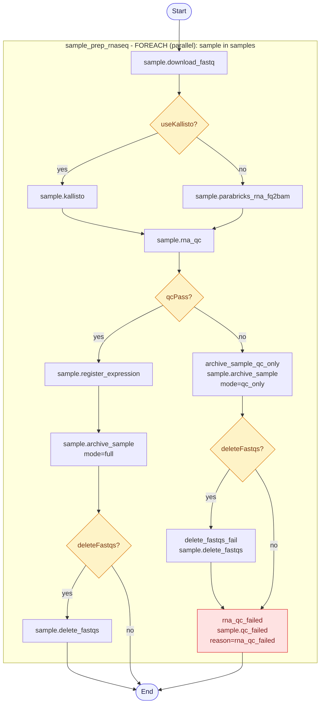
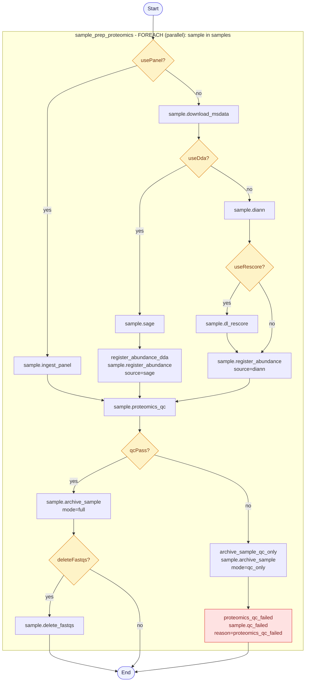

# Module 3: Assays, Analytes & Process Packs

*Genomics with GoliathOmics · Goliath Research Academy* · [Course syllabus](../README.md)

**Notebook:** `03_in_silico_bisulfite.py` · **Support code:** `module_03_assays.py` ·
**Diagrams:** [diagrams/README.md](../diagrams/README.md) and [GoliathOmics DomainProgram catalog](https://goliath-research.github.io/GoliathOmics/workflows/) ·
**Sources:** GoliathOmics `docs/operators/process-packs.md`, `docs/ANALYTE_PROFILES.md`,
`docs/usage/20-rnaseq-process-pack.md`, `22-proteomics-process-pack.md`,
`24-methylation-application-packs.md`, `21-…`, `23-…`, `25-prostate-cancer-pack.md`,
`workflow_engine/domain/profiles/procedures/*.procedure.json`

## Goal

GoliathOmics is not a methylation tool with extras. It is a platform for many assays, and any
customer can change the technology. This module teaches the model that makes that possible:
**modality → analyte → technique (assay procedure) → application pack**, and what each layer
switches on. Methylation is the worked example; RNA-seq and proteomics use the same model.

## 3.1 Four layers

| Layer | Question it answers | Operator field | Where it lives | Values today |
|---|---|---|---|---|
| **Modality** (process pack) | What molecule is measured? | `regulatory.primary_modality` | Profile and study; enforced by `workflow_engine/domain/modality_gate.py` | `methylation`, `rnaseq`, `proteomics` |
| **Analyte** | What sample matrix? | `regulatory.primary_analyte` | `workflow_engine/domain/analytes/*.analyte.json` → `cfg.analyte` | `buffy_coat`, `cfdna`, `tissue`, `plant_tissue`, `combined` |
| **Technique** (assay procedure) | How was the library made and scored? | `pipelineProcedure` (`libraryProtocol` inside) | `workflow_engine/domain/profiles/procedures/*.procedure.json` → `cfg.assay_procedure` | 8 methylation procedures; `libraryProtocol` ∈ `wgbs_linear`, `wgbs_pangenome`, `epi_gbs`, `emseq_targeted` |
| **Application pack** | Which disease or trait, which cohorts? | project manifest + small `actionConfig` overlay | `docs/examples/samd/*` | Alzheimer cfDNA, plant abiotic stress, prostate cancer options catalog |

There is no disease table. A disease or trait study is an *application pack*: cohorts,
patient-disjoint partitions and an overlay on a procedure that already exists.

## 3.2 Modalities (process packs)

| Modality | SamplePrep program | Front end | Output seam | Study program | Profile |
|---|---|---|---|---|---|
| Methylation | `sample_prep.program.json` (+ `_emseq`, `_epigbs`, `_remediate`) | Bisulfite/enzymatic alignment (4 paths, Module 5) → extraction | per-chromosome `{chr}-CG.h5` | `study_validation_lifecycle` | `samd_research` and others |
| RNA-seq | `sample_prep_rnaseq.program.json` | STAR (`pbrun rna_fq2bam`) **or** kallisto (`actionConfig.rna_align.quant_mode`) | `{sample_id}.expression.h5` (`gene_id`, `count`, `tpm`) | `rnaseq_study_lifecycle` (`pipeline.rna_de_select`) | `rnaseq_research` |
| Proteomics | `sample_prep_proteomics.program.json` | DIA-NN (`dia`, optional Prosit rescoring), Sage (`dda`, CPU), or panel ingest (`panel`: Olink NPX, SomaScan RFU) via `actionConfig.proteomics_quant.ingest_mode`; Casanovo de novo as a complement | `abundance.h5` | `proteomics_study_lifecycle` (`pipeline.protein_de_select`) | `proteomics_research` |

RNA-seq and proteomics share a **samples × features** seam, so the classifier, covariate stacking
and stability analysis downstream are the same code. Bisulfite QC and blood cell deconvolution do
not apply to them; their QC gates on mapping/pseudoalignment rate and genes detected
(`sample.rna_qc`) or proteomics QC.

In the lab, `wf.workflow_def` holds all seven deployed definitions:
`SamplePrepPipeline`, `SamplePrepRemediationPipeline`, `SamplePrepRnaSeqPipeline`,
`SamplePrepProteomicsPipeline`, `StudyValidationLifecycle`, `RnaSeqStudyLifecycle`,
`ProteomicsStudyLifecycle`.

Rather than reading raw JSON to compare modalities, inspect their generated Mermaid flowcharts
(all 41 exported in [`diagrams/`](../diagrams/README.md) and published at
[GoliathOmics DomainProgram catalog](https://goliath-research.github.io/GoliathOmics/workflows/sample-prep/)).
Notice how RNA-seq and proteomics share the exact same `FOREACH samples → branch on config → QC gate → archive or fail` shape as methylation (`SamplePrepPipeline`, shown in full in Module 9):

#### RNA-seq SamplePrep (`SamplePrepRnaSeqPipeline` — `diagrams/sample_prep_rnaseq.mmd`)



#### Proteomics SamplePrep (`SamplePrepProteomicsPipeline` — `diagrams/sample_prep_proteomics.mmd`)



## 3.3 Analytes

The analyte is the sample matrix. It fills in defaults the operator did not set (it never
overrides an explicit value):

| Step | `cfdna` | `buffy_coat` | `plant_tissue` |
|---|---|---|---|
| Alignment QC | fragmentomics + guardrails + bisulfite QC | guardrails + bisulfite QC | guardrails (min mapping 0.90), non-CpG cap opened |
| Fragmentomics | enabled (WPS + end motifs) | off | off |
| Extraction QC | CHG/CHH caps 0.02 | caps 0.02 | caps lifted to 1.0 (plant non-CG is biology) |
| Cell deconvolution | Houseman or HiTIMED plasma tree | Houseman or HiTIMED immune | not applicable |

Source: the "What each analyte enables" table in `docs/ANALYTE_PROFILES.md`. `combined` (used by
this course's cell-line sample) gets bisulfite QC defaults only. The study's analyte must match the
procedure's `analyteExpectation`.

## 3.4 Techniques (assay procedures)

| Procedure | Analyte | `libraryProtocol` | Notes |
|---|---|---|---|
| `buffy_wgbs_pangenome_gene_fc` | `buffy_coat` | `wgbs_pangenome` | default; methylGrapher on the HPRC graph |
| `buffy_wgbs_linear_gene_fc` | `buffy_coat` | `wgbs_linear` | Clara Parabricks `fq2bam_meth` |
| `buffy_wgbs_linear_mojo_gene_fc` | `buffy_coat` | `wgbs_linear` | same node, GoliathAlign engine |
| `buffy_wgbs_mvalue_residual_gene_fc` | `buffy_coat` | `wgbs_pangenome` | M-value residualization lifecycle |
| `cfdna_wgbs_plasma` | `cfdna` | `wgbs_linear` | fragmentomics, no deconvolution |
| `cfdna_emseq_targeted` | `cfdna` | `emseq_targeted` | enzymatic conversion, panel BED |
| `cfdna_emseq_mhl_survival` | `cfdna` | `emseq_targeted` | methylation haplotype load + Cox |
| `plant_wgbs_gene_fc` | `plant_tissue` | `wgbs_linear` | plant lifecycle |

Each procedure file also names its `samplePrepProgram` and `lifecycleProgram`. cfDNA procedures use
`study_validation_lifecycle_no_deconv` (no blood cell deconvolution), EM-Seq uses
`sample_prep_emseq`, the plant procedure uses `plant_stress_study_lifecycle`.

`epi_gbs` (reduced-representation bisulfite for plants) runs `sample_prep_epigbs.program.json`,
which aligns with `sample.docker_align`.

## 3.5 Application packs

| Pack | Kind | Procedure | What it adds |
|---|---|---|---|
| Alzheimer cfDNA | disease | `cfdna_wgbs_plasma` | staged Control → MCI → AD cohorts, `neuro-core` enrichment |
| Plant abiotic stress | trait | `plant_wgbs_gene_fc` | Control vs drought; TAIR10 and crop site references; CG/CHG/CHH all treated as signal |
| Prostate cancer | disease, multi-path catalog | buffy, plasma, EM-Seq or tissue | an options tree; registered evidence packages are **feasibility only** |

No new aligner, action or program is needed for any of them. That is the point of the model.

## 3.6 The chemistry behind the methylation example

DNA methylation (5-methylcytosine) mostly sits at CpG in mammals and also at CHG/CHH in plants.
Bisulfite (WGBS) or enzymatic (EM-Seq) conversion turns **unmethylated** C into U (read as T);
methylated C stays C. Methylation becomes a C/T difference, which is why alignment and QC differ
from ordinary DNA sequencing:

* reads are mostly three-letter (A, G, T on the converted strand), so aligners must compare against
  converted references (Module 5);
* the conversion rate is estimated from cytosines that should be unmethylated (non-CpG in mammals),
  and a low rate makes every call look more methylated than it is (Module 7).

## Lab sequence

1. In `psql`, list the catalog rows behind each layer:

   ```sql
   SELECT name, status FROM cfg.analyte ORDER BY 1;                 -- 5 rows, all published
   SELECT name FROM cfg.assay_procedure ORDER BY 1;                 -- 8 rows
   SELECT name FROM cfg.pipeline_profile WHERE name LIKE '%research' ORDER BY 1;
   -- proteomics_research, rnaseq_research, samd_research
   SELECT name FROM wf.workflow_def ORDER BY 1;                      -- 7 rows
   ```

2. Open the notebook: `marimo edit "3 - Assays, Analytes & Process Packs/03_in_silico_bisulfite.py"`.
   Convert a sequence, choose which CpGs are methylated, and watch the estimated conversion rate
   drop when you simulate incomplete conversion.

3. Use the pack chooser in the notebook: pick a modality, analyte and technique and inspect both
   the resolved settings table and the live rendered SamplePrep and Study Lifecycle Mermaid
   diagrams (`mo.mermaid`) that update for your selection.

## Practice

* A customer moves from WGBS on buffy coat to targeted EM-Seq on plasma. Which layers change? Which
  GoliathApp objects change? (Procedure and analyte; none.)
* A plant sample shows 30% CHH methylation. Is that a conversion failure? Which analyte value tells
  the QC that?
* Name the RNA-seq and proteomics equivalents of `{chr}-CG.h5`.

## Evidence to submit

* The four query results.
* A table, in your own words, of one study per modality: modality, analyte, procedure or quant
  mode, program, output file.

## Handoff to Module 4

Each modality produces files. Module 4 explains the genome and data representations behind them.
