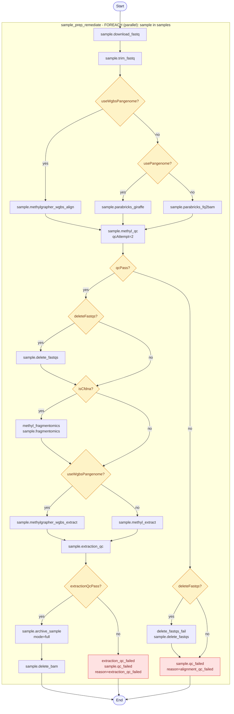

# Module 7: QC at Every Level

*Genomics with GoliathOmics · Goliath Research Academy* · [Course syllabus](../README.md)

**Notebook:** `07_guardrail_what_if.py` · **Support code:** `module_07_qc.py` ·
**Sources:** GoliathOmics `docs/usage/03-sample-prep-and-qc.md`,
`schemas/config/sample_prep_guardrails.schema.json`, `docs/architecture/site-parameters.md`,
`packages/{methylalignmentqc,methylextractionqc,methylfragmentomics,rnaalignmentqc,proteomicsqc}`,
`docs/usage/10-artifacts-and-qa-checks.md`

## Goal

Know what is checked at each layer, for each modality, which default applies, and what the
pipeline does when a gate fails: continue, remediate, or reject.

## 7.1 Layers

| Layer | Examples | Default (schema) |
|---|---|---|
| Sequencing | PF %, %Q30, mean quality, per-cycle dips | `min_pf_percent` 90, `min_q30_percent` 85, `min_mean_quality` 35 |
| Library | insert size, duplication, GC/AT dropout, OxoG, deamination | `median_insert_min_bp` 150, `median_insert_max_bp` 300, `max_gc_dropout` 5.0, `max_at_dropout` 3.0 |
| Alignment | mapping rate, properly paired, secondary/supplementary | `min_mapping_rate` 0.98, `min_properly_paired_rate` 0.9, `max_secondary_supplementary_rate` 0.05 |
| Bisulfite conversion | conversion rate, non-CpG methylation | `min_conversion_rate_pct` 99.0, `max_non_cpg_methylation_pct` 2.0 |
| cfDNA fragmentomics | short-fragment fraction, nucleosome peak | `max_short_fragment_fraction` 0.35, peak 140–200 bp (off unless the analyte enables it) |
| Extraction | CpG coverage, autosomal uniformity, CHG/CHH caps | `min_cpg_weighted_mean_coverage` 10.0, uniformity ratio ≥ 0.5, `max_chg/chh_methylation_level` 0.02 |
| RNA-seq | input reads, mapping / unique / pseudoalignment rate, genes detected | `min_input_reads` 1,000,000, `min_mapping_rate` 0.5, `min_uniquely_mapped_rate` 0.4, `min_genes_detected` 5000 |
| Proteomics | proteins identified, missing fraction | `min_proteins_identified` 300, `max_missing_fraction` 0.9 |
| Study and model | stability, freeze readiness, balanced accuracy | study artifacts (`docs/usage/10-artifacts-and-qa-checks.md`) |

Defaults are only defaults. The site publishes the core window; analytes fill missing values
(`plant_tissue` opens the non-CpG and CHG/CHH caps; `cfdna` enables fragmentomics). Module 8 shows
the overlay order.

## 7.2 The methylation SamplePrep gates

Two gates (`docs/usage/03-sample-prep-and-qc.md`):

| Gate | Scope variable | When | Blocks |
|---|---|---|---|
| Alignment (`sample.methyl_qc`) | `qcPass` | after alignment, before extraction | extraction (unless remediation succeeds) |
| Extraction (`sample.extraction_qc`) | `extractionQcPass` | after extraction | full archive and BAM deletion |

A fixable read-end quality failure goes through **remediation**: `sample.trim_fastq` (fastp) →
forced realign on the **same** align path → QC retry. A terminal failure archives QC only
(`archive_qc_only`). FASTQs stay until QC is resolved so the trim can happen. RNA-seq uses
`sample.rna_qc`; proteomics uses `sample.proteomics_qc`; both end in archive or `qc_failed`.

The diagram below is generated directly from `sample_prep_remediate.program.json`
([`diagrams/sample_prep_remediate.mmd`](../diagrams/sample_prep_remediate.mmd)) and shows both
gates (`qcPass?` and `extractionQcPass?`) after `sample.trim_fastq` and realignment. See
[`diagrams/sample_prep.mmd`](../diagrams/sample_prep.mmd) (embedded in Module 9) or the
[published SamplePrep diagrams](https://goliath-research.github.io/GoliathOmics/workflows/sample-prep/)
for the full first-pass + retry graph:

## 7.3 What a QC result is, as a record

Each gate writes a JSON (`alignment_qc/{sample_id}.json`, `{sample_id}.extraction_qc.json`) with
`guardrails.overall_pass`, each threshold, its normal range and pass/fail. That JSON is evidence in
Module 12: it shows which threshold was applied, not only the outcome.

## Lab sequence

1. Open the notebook. The first panel shows real numbers from the fixture: R1 %Q30 87.5 (passes
   85) and mean quality 34.66 (below 35). Why is that **not** a QC decision about the run?
2. Move metrics until each gate fails once. Record the next step for each, with and without
   "already remediated".
3. `pytest tests/test_module_07.py -v`. One test reads the **pinned schema** and fails if the
   course's default table drifts from GoliathOmics.

## Practice

* A cfDNA sample has 40% short fragments. Which gate? Does a buffy coat sample get that check?
* A plant sample shows CHH 0.15. Pass or fail, and why?
* An RNA-seq sample detects 3,800 genes. Which action fails it, and which knob would a site change?

## Evidence to submit

* Your what-if table (gate, metric, threshold, result, next step).
* The pytest output.

## Handoff to Module 8

Every threshold you moved is configuration. Module 8 shows who owns each value and why the merged
configuration is part of the result.
