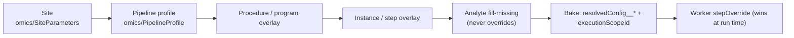

# Module 8: Configuration as a Controlled Artifact

*Genomics with GoliathOmics · Goliath Research Academy* · [Course syllabus](../README.md)

**Notebook:** `08_overlay_merge.py` · **Support code:** `module_08_overlay.py` ·
**Sources:** GoliathOmics `docs/architecture/site-parameters.md` ("Precedence"),
`packages/methylutils/methyl_utils/action_config_resolver.py`, `analyte_profiles.py`,
`workflow_engine/domain/workflow_context.py`, `src/goliath_omics/seed/config_document_types.py`,
`docs/usage/17-content-addressed-action-store.md`, `docs/usage/18-samd-study-lifecycle.md`

## Goal

In regulated software the configuration is part of the device: the same binary with a different
threshold gives a different result. Predict the effective configuration of any step, name the layer
that owns each value, and explain how the merged result is frozen with the run.

## 8.1 Layers and precedence



Rules (`resolve_action_config`, `deep_merge`):

* later layers win; nested objects merge key by key; lists and scalars replace;
* a JSON `null` in an overlay **deletes** the key (how an operator clears a site cap);
* the analyte only **fills missing** keys (`merge_step_config`); explicit values always win;
* `regulatory.auto_apply_analyte_profile: false` turns the analyte step off;
* the study manifest never carries tool knobs (`step_config` is rejected).

## 8.2 Typed documents, not pasted JSON

Site parameters and pipeline profiles are typed Meta documents (`omics/SiteParameters`, cfg kind
`site`; `omics/PipelineProfile`, cfg kind `pipeline_profile`) registered by
`goliath-omics-seed-config-document-types` and edited in GoliathApp's generic typed grid. There is
no free-form JSON editor in the platform. Each published `cfg` row carries `version`, `status` and
`content_hash`.

## 8.3 Baking freezes the configuration

`finalize_instance_context` writes `resolvedConfig__<key>` scope variables and an
`executionScopeId` derived from all merged slices. Workers read only `resolvedConfig`. The CAAS
`content_key` (Module 9) includes the action revision and its input signature, so a changed
threshold forks the content key: the platform cannot silently reuse a result computed under a
different configuration.

Known limitation (documented): there is no `wf.cluster.site_id` link, so a cluster's workers see
the site baked for the instance.

## Lab sequence

1. The published documents behind the lab study:

   ```sql
   SELECT 'site' AS kind, name, version, status, left(content_hash, 12) FROM cfg.site
   UNION ALL SELECT 'profile', name, version, status, left(content_hash, 12)
     FROM cfg.pipeline_profile WHERE name = 'samd_research'
   UNION ALL SELECT 'procedure', name, version, status, left(content_hash, 12)
     FROM cfg.assay_procedure WHERE name = 'buffy_wgbs_linear_gene_fc';
   SELECT name, document_json->>'pipelineProfile' AS profile,
          document_json->>'pipelineProcedure' AS procedure
   FROM cfg.study;
   ```

   Expect `academy_lab_site`, `samd_research`, `buffy_wgbs_linear_gene_fc`, all `published`, and
   study `academy_ena_srr28293403`.

2. Open the notebook. Toggle each layer and the analyte; record who sets
   `alignment_guardrails.min_mapping_rate` and `fragmentomics.enabled` in four scenarios: site only;
   + profile; + procedure `null` on `cycle_screening`; + instance overlay.

3. `pytest tests/test_module_08.py -v`. With the pinned GoliathOmics source present, the tests run
   the **official** `resolve_action_config` on the shipped `site_grch38.example.json` and check the
   same rules: instance beats profile, `null` deletes, the analyte fills but never overrides.

## Practice

* A site sets `max_chh_methylation_level` 0.02 and a plant study needs 1.0. Which layer should
  change, and why not the site?
* Two runs of the same sample differ only in `min_mapping_rate`. Will the second reuse the first
  run's QC result? (No: different input signature, different content key.)

## Evidence to submit

* The query output and your four-scenario table.
* The pytest output.

## Handoff to Module 9

You know what configuration a step ran with. Module 9 shows where the platform records that the
step ran at all.
