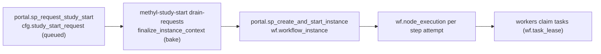

# Module 9: Workflows, Workers & the Execution Record

*Genomics with GoliathOmics · Goliath Research Academy* · [Course syllabus](../README.md)

**Lab:** PostgreSQL 19 lab · **SQL:** `09_execution_record.sql` ·
**Sources:** GoliathOmics `docs/operators/start-sample-prep.md`,
`workflow_engine/domain/fixtures/*.program.json`, `workers/methyl_worker/{sample_prep_log,action_run_log}.py`,
`docs/usage/17-content-addressed-action-store.md`; GoliathApp `workflow_engine/sql_pg/00_schema.sql`,
`wf_event_plane.sql`, `docs/history-and-audit.md` (GoliathApp PR #109)

## Goal

Know every place the platform records that something happened: which workflow, which version,
which step, which attempt, with which inputs, configuration and result, and who changed the model
or the configuration. Also know where the record is incomplete today.

"Run" has two meanings in this course. A **sequencing run** is a lab event (Module 2). A
**workflow instance** is a software run. Keep them apart.

## 9.1 From intent to instance



Programs are typed DomainPrograms (`sample_prep.program.json` and the modality variants),
compiled and versioned by `scripts/deploy_workflow_definitions.sh` into `wf.workflow_def` /
`wf.workflow_version`. The lab holds 7 definitions and one queued SamplePrep request for the public
sample.

## 9.2 The database record (GoliathApp)

| Table | What it records |
|---|---|
| `wf.workflow_def`, `wf.workflow_version` | definitions and immutable versions |
| `wf.workflow_instance` | one software run: status, `context_json`, start/end UTC |
| `wf.node_execution` | one step attempt: `attempt_no`, `iteration_no`, `input_json`, `output_json`, `result_code`, engine errors, start/end UTC |
| `wf.scope_variable` | baked values, including `resolvedConfig__*` and `executionScopeId` |
| `wf.execution_scope`, `wf.execution_scope_action_entry` | the execution scope mirror |
| `wf.worker`, `wf.task_lease` | which worker held which task |
| `wf.event`, `wf.event_delivery` | the event plane (`source`, `idempotency_key`, `correlation_key`) |
| `portal.*_audit` | who changed records, the model, security, roles, God Architect catalog |

## 9.3 The file record (GoliathOmics)

| File | Written by |
|---|---|
| `{sampleDir}/{sample_id}.sample_prep_log.jsonl` | one line per prep action: inputs, outputs, attempt, result code, node key |
| `{logRoot}/action_run_log.jsonl` | every action run |
| `{output_dir}/.action_results/{action}.{run_key}.json` | per-action manifests |
| `.caas/` | content-addressed results: `content_key = sha256(action_revision \| input_signature)` |

Identical inputs and configuration give an identical content key, so a result can be reused only
when nothing that matters changed.

## 9.4 Where the record has gaps today, and what is changing

David's requirement is **history must exist, with no gaps**. GoliathApp is closing the platform
side in a stack of pull requests (`docs/history-and-audit.md`):

| Slice | Adds | Status (Nov 22, 2026) |
|---|---|---|
| H1 ledger core | append-only, hash-chained ledgers for the `portal.*_audit` tables, `"Onboarding"."AuditLog"`, `wf.event`, `wf.event_delivery`; `fn_ledger_verify`, `fn_ledger_verify_all`, `fn_ledger_checkpoint` | GoliathApp PR #109, open |
| H2 Meta object history | `"Meta"."ObjValuesHistory"` | follow-up PR |
| H3 run history and retention | run-history ledger, no cascading deletes of runs, `platform/RetentionPolicy` with tombstones | follow-up PR |
| H4 electronic signatures | `platform/ElectronicSignature` | follow-up PR |

Gaps you can see in the lab right now (the exercise below makes you find them):

* `cfg.study_start_request` changes status in place (`queued` → `failed`/`succeeded`); earlier
  states are overwritten.
* GoliathOmics clinical writes (`omics.patient.create`, …) go to `portal."Patients"` etc. No audit
  table receives a row, and the Meta mirror is updated only when the dual-write flag is on
  (`omics_clinical.meta_cutover_flag`, all `false` in a fresh database) or by backfill.
* `omics/SequencingRun` and `omics/AlignmentResult` are registered classes with no writer; run and
  alignment facts live in `wf` rows and files.
* The JSONL logs are append-only by convention, not tamper-evident.

Module 12 builds the evidence package on the H1–H4 features as they merge and lists what still
needs a GoliathOmics change (for example, feeding Omics records into H2 history).

## Lab sequence

Run `09_execution_record.sql` (`python course_lab.py sql "9 - Workflows, Workers & the Execution Record/09_execution_record.sql"`, or paste sections into `python course_lab.py psql`):

1. Definitions and versions: 7 definitions, each with an active version.
2. The queued request for `academy_ena_srr28293403` and its baked fields.
3. Try the drain **in the lab** (it needs no worker and spends nothing):

   ```bash
   docker compose run --rm --entrypoint bash seed /course/lab/drain_once.sh
   ```

   It fails because the lab has no materialized `/work/projects/...` project file. Look at the
   request row again: `status = failed` and `error_message` explain why. What happened to the
   `queued` state?
4. Audit tables: `portal.session_active_role_audit` gains a row each time the portal smoke signs
   in; the clinical tables gain no audit row when the importer writes a patient.

## Practice

* Which table would tell you which worker ran a step, and which file would tell you the input
  checksums?
* Name two facts about a run that live only in files today.

## Evidence to submit

* Query output for steps 1, 2 and 4, and the request row after your drain attempt.
* A list of the gaps you found, each mapped to H1, H2, H3, H4 or "needs a GoliathOmics change".

## Handoff to Module 10

The record shows *that* a result was produced. Module 10 asks whether the study design lets anyone
trust what the result claims.
