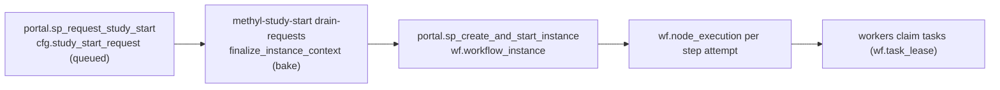

# Module 9: Workflows, Workers & the Execution Record

*Genomics with GoliathOmics · Goliath Research Academy* · [Course syllabus](../README.md)

**Lab:** PostgreSQL 19 lab · **SQL:** `09_execution_record.sql` ·
**Sources:** GoliathOmics `docs/operators/start-sample-prep.md`,
`workflow_engine/domain/fixtures/*.program.json`, `workers/methyl_worker/{sample_prep_log,action_run_log}.py`,
`docs/usage/17-content-addressed-action-store.md`; GoliathApp `workflow_engine/sql_pg/00_schema.sql`,
`wf_event_plane.sql`, `docs/history-and-audit.md` (GoliathApp PR #109)

## Goal

Know every place the platform records that something happened: which workflow, which version,
which step, which attempt, with which inputs, configuration and result, and who changed the model
or the configuration. Also know where the record is incomplete today.

"Run" has two meanings in this course. A **sequencing run** is a lab event (Module 2). A
**workflow instance** is a software run. Keep them apart.

## 9.1 From intent to instance



Programs are typed DomainPrograms (`sample_prep.program.json` and the modality variants),
compiled and versioned by `scripts/deploy_workflow_definitions.sh` into `wf.workflow_def` /
`wf.workflow_version`. The lab holds 7 definitions and one queued SamplePrep request for the public
sample.

## 9.2 The database record (GoliathApp)

| Table | What it records |
|---|---|
| `wf.workflow_def`, `wf.workflow_version` | definitions and immutable versions |
| `wf.workflow_instance` | one software run: status, `context_json`, start/end UTC |
| `wf.node_execution` | one step attempt: `attempt_no`, `iteration_no`, `input_json`, `output_json`, `result_code`, engine errors, start/end UTC |
| `wf.scope_variable` | baked values, including `resolvedConfig__*` and `executionScopeId` |
| `wf.execution_scope`, `wf.execution_scope_action_entry` | the execution scope mirror |
| `wf.worker`, `wf.task_lease` | which worker held which task |
| `wf.event`, `wf.event_delivery` | the event plane (`source`, `idempotency_key`, `correlation_key`) |
| `portal.*_audit` | who changed records, the model, security, roles, God Architect catalog |

## 9.3 The file record (GoliathOmics)

| File | Written by |
|---|---|
| `{sampleDir}/{sample_id}.sample_prep_log.jsonl` | one line per prep action: inputs, outputs, attempt, result code, node key |
| `{logRoot}/action_run_log.jsonl` | every action run |
| `{output_dir}/.action_results/{action}.{run_key}.json` | per-action manifests |
| `.caas/` | content-addressed results: `content_key = sha256(action_revision \| input_signature)` |

Identical inputs and configuration give an identical content key, so a result can be reused only
when nothing that matters changed.

## 9.4 Where the record has gaps today, and what is changing

David's requirement is **history must exist, with no gaps**. GoliathApp is closing the platform
side with a stack of pull requests, now merged (`docs/history-and-audit.md`):

| Slice | Adds | Status |
|---|---|---|
| H1 ledger core | append-only, hash-chained ledgers for the `portal.*_audit` tables, `"Onboarding"."AuditLog"`, `wf.event`, `wf.event_delivery`; `fn_ledger_verify`, `fn_ledger_verify_all`, `fn_ledger_checkpoint` | GoliathApp PR #109, merged |
| H2 Meta object history | `"Meta"."ObjValuesHistory"` | GoliathApp PR #110, merged |
| H3 run history and retention | run-history ledger, no cascading deletes of runs, `platform/RetentionPolicy` with tombstones | GoliathApp PR #111, merged |
| H4 electronic signatures | `platform/ElectronicSignature` | GoliathApp PR #112, merged |
| UTC timestamps | every `*_at_utc` default and write is a true instant in any session time zone | GoliathApp PR #113, merged |

Gaps that remain (the exercise below makes you find them):

* `cfg.study_start_request` changes status in place (`queued` → `failed`/`succeeded`); earlier
  states are overwritten.
* GoliathOmics clinical writes (`omics.patient.create`, …) go to `portal."Patients"` etc. The Meta
  mirror is updated only when the dual-write flag is on (`omics_clinical.meta_cutover_flag`, all
  `false` in a fresh database) or by backfill; since GoliathOmics #116 every change is kept in
  `omics_clinical.record_history`.
* The JSONL logs are append-only by convention, not tamper-evident.

## Runs and alignments as Meta objects

GoliathOmics #119 turns two kinds of `wf.node_execution` row into Meta objects. Nobody types JSON:
the objects come from the workflow engine.

| Source step (status `SUCCEEDED`) | Object | Main fields |
|---|---|---|
| `sample.download_fastq` | `omics/SequencingRun` | `run_accession` (only when every FASTQ name agrees on one SRR/ERR/DRR), `fastq_files`, `fastq_count`, `ingested_at_utc` |
| `sample.parabricks_fq2bam`, `parabricks_rna_fq2bam`, `parabricks_giraffe`, `docker_align`, `methylgrapher_wgbs_align` | `omics/AlignmentResult` | `sequencing_run_id`, `aligner_action`, `align_engine`, `bam_path`, `output_dir`, `qc_metrics_path`, `completed_at_utc` |

Every object also carries:
- `source_node_execution_id` and `workflow_instance_id`, pointing back to the step that produced it.
- `sample_name`, with `sample_id` → `omics/Sample` when `portal."Samples"` has that name.
- `study_id` → `omics/Study` when `cfg.study_instance_link` ties the instance to a study.

A link that is not known stays out of the document; nothing is invented.

The table `omics_clinical.wf_meta_object_source` lists which actions produce which class. You
add a new aligner by adding a row there, not by changing code.

How it is written:

* **Writers are class methods.** `"Meta"."Methods"` lists:
  * `omics/SequencingRun.RecordFromNodeExecution` → `omics_clinical.sp_sequencing_run_record`
  * `omics/AlignmentResult.RecordFromNodeExecution` → `omics_clinical.sp_alignment_result_record`
  * `Backfill` on both classes → `omics_clinical.sp_run_alignment_backfill`

  They write through `"Meta".sp_obj_insert` / `sp_obj_update`, so H2
  (`"Meta"."ObjValuesHistory"`) records `object.create`, `values.insert` / `values.update` and
  `object.scope`. Objects are scoped like their study.
* **Engine hook.** An AFTER trigger on `wf.node_execution` calls the writer when a step becomes
  `SUCCEEDED`. A writer error is only a WARNING: it never fails the engine. The step stays in
  `omics_clinical.v_run_alignment_pending` until someone runs the backfill.
* **Idempotent per step.** `omics_clinical.wf_meta_object_link` has primary key
  (`source_node_execution_id`, `class_name`) and keeps a SHA-256 of the document. A rerun with the
  same facts writes nothing and adds no history row. A changed fact updates the same object. The
  link table is itself tracked in `omics_clinical.record_history`. It has no foreign key to the
  step, so H3 run retention can purge a run and keep the object.
* **Backfill.** `scripts/omics_run_alignment_backfill.sh` does a dry run by default and commits
  with `--apply`. It prints `source_rows`, `created` and `updated` per class. A second `--apply`
  reports `created=0 updated=0`.

A fresh lab has no successful steps (the drain below fails on purpose), so both classes have **0**
objects and **0** source rows. Those numbers matching is the check. On the platform database (23 Nov 2026) the
backfill derived 6 runs and 6 alignments from the six migrated SamplePrepPipeline instances; a second
pass created and updated nothing.

Module 12 builds the evidence package on the H1–H4 features and lists what still needs a change.
GoliathOmics PR #116 (merged) keeps a history of every change to the relational clinical tables
and registers it as an H1 ledger; GoliathOmics PR #117 (merged) applies the UTC rule to Omics.

## Lab sequence

Run `09_execution_record.sql` (`python course_lab.py sql "9 - Workflows, Workers & the Execution Record/09_execution_record.sql"`, or paste sections into `python course_lab.py psql`):

1. Definitions and versions: 7 definitions, each with an active version.
2. The queued request for `academy_ena_srr28293403` and its baked fields.
3. Try the drain **in the lab** (it needs no worker and spends nothing):

   ```bash
   docker compose run --rm --entrypoint bash seed /course/lab/drain_once.sh
   ```

   It fails because the lab has no materialized `/work/projects/...` project file. Look at the
   request row again: `status = failed` and `error_message` explain why. What happened to the
   `queued` state?
4. Audit tables: `portal.session_active_role_audit` gains a row each time the portal smoke signs
   in; the clinical tables gain no audit row when the importer writes a patient.
5. Clinical writes and the Meta mirror switch.
6. Runs and alignments: the writer methods on both classes, the engine hook, and objects equal to
   successful source steps (0 = 0 in a fresh lab). The backfill dry run creates nothing.

## Practice

* Which table would tell you which worker ran a step, and which file would tell you the input
  checksums?
* Name two facts about a run that live only in files today. (The BAM path and the run accession
  are now on the Meta objects; the checksums and tool logs are not.)
* Which table would you change to make a new aligner action produce `omics/AlignmentResult`
  objects, and which script would record its past successful steps?

## Evidence to submit

* Query output for steps 1, 2, 4 and 6, and the request row after your drain attempt.
* A list of the gaps you found, each mapped to H1, H2, H3, H4 or "needs a GoliathOmics change".

## Handoff to Module 10

The record shows *that* a result was produced. Module 10 asks whether the study design lets anyone
trust what the result claims.
