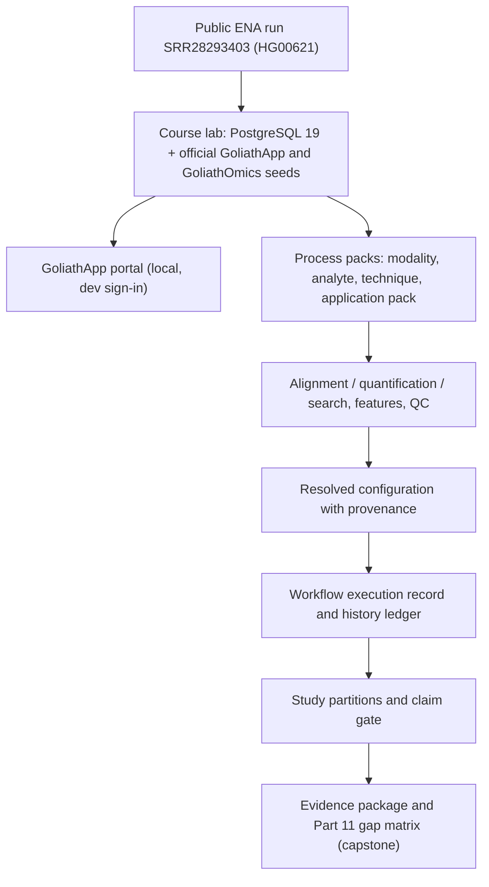

# Genomics with GoliathOmics

*Enterprise Platforms with GoliathApp · Course 2 · Goliath Research Academy*

> **Status (Nov 2026).** All twelve module guides, the Marimo notebooks for Modules 3–8 and 10,
> and the lab are written. The lab is a disposable PostgreSQL 19 database seeded with the
> official GoliathApp and GoliathOmics apply and seed scripts, plus the GoliathApp portal run
> locally in dev mode. It was verified end to end on PostgreSQL 19 with the portal: navigation
> and the semantic lists show the public ENA rows. The lab pins GoliathApp and GoliathOmics `main`
> commits that include the merged history work: GoliathApp #109–#112 (ledgers, Meta object
> history, run history and retention, e-signatures) and #113 (UTC timestamps), and GoliathOmics
> #113 and #115 (catalog kinds, omics permissions), #116 (clinical record history) and #117 (UTC
> timestamps). Module 12 teaches those features and checks for each one before using it. The only biological data is public ENA run
> SRR28293403 (HG00621). GoliathOmics is not FDA-cleared or approved, and this course does not
> claim it complies with 21 CFR Part 11.

**Delivery format:** module reference guides (`NN_content.md`), Marimo notebooks where a concept
is clearer when you can change it, generated [Mermaid workflow diagrams](diagrams/README.md) for all
41 GoliathOmics DomainPrograms (matching the published [GoliathOmics DomainProgram catalog](https://goliath-research.github.io/GoliathOmics/workflows/)),
SQL lab scripts, and pytest checks.

## Prerequisites

* *GoliathApp* (Course 1 of this series, in preparation): Meta classes and objects, actions as
  class methods, scopes and roles, the portal.
* *PostgreSQL with Python* (Relational Databases with Python, Course 2): SQL, transactions,
  Docker Compose labs.
* Basic Python. No biology background is assumed; Module 2 starts from the specimen.

## What you'll build



## Learning outcomes

1. Explain what a child application adds to GoliathApp and why GoliathApp knows nothing about omics.
2. Describe every documented GoliathOmics scenario: methylation, RNA-seq and proteomics
   modalities; buffy coat, cfDNA, tissue, plant tissue and combined analytes; the eight assay
   procedures; and the application packs.
3. Read FASTQ, SAM/BAM, methylation calls, count matrices and proteomics reports, and the shared
   feature-store contract.
4. Predict the effective configuration of a step from site, profile, procedure, instance and
   analyte layers, and the QC decision it produces.
5. Find every place the platform records an execution, and every gap in that record.
6. Explain the premarket routes and Part 11 controls, and assemble an evidence package from real
   platform records without inventing values.

## Twelve-module lesson plan

| Module | Lab | Notebook | Evidence of completion |
|---|---|---|---|
| [1 - From GoliathApp to GoliathOmics](1%20-%20From%20GoliathApp%20to%20GoliathOmics/01_content.md) | class and action catalog queries | | class map with parents and actions |
| [2 - The Genomics Lab End to End](2%20-%20The%20Genomics%20Lab%20End%20to%20End/02_content.md) | the HG00621 sample in the portal | | specimen-to-file map |
| [3 - Assays, Analytes & Process Packs](3%20-%20Assays,%20Analytes%20&%20Process%20Packs/03_content.md) | procedures and analytes in the lab | `03_in_silico_bisulfite.py` | scenario selection memo |
| [4 - Genome & Data Representations](4%20-%20Genome%20&%20Data%20Representations/04_content.md) | read the public FASTQ fixture | `04_fastq_and_sam_anatomy.py` | annotated records |
| [5 - Alignment, Quantification & Search](5%20-%20Alignment,%20Quantification%20&%20Search/05_content.md) | align modes and engines | `05_three_letter_alignment.py` | path per modality |
| [6 - From Alignments to Feature Matrices](6%20-%20From%20Alignments%20to%20Feature%20Matrices/06_content.md) | feature-store files | `06_feature_matrices.py` | matrix + contract check |
| [7 - QC at Every Level](7%20-%20QC%20at%20Every%20Level/07_content.md) | guardrail defaults from the schema | `07_guardrail_what_if.py` | QC decision table |
| [8 - Configuration as a Controlled Artifact](8%20-%20Configuration%20as%20a%20Controlled%20Artifact/08_content.md) | overlay resolution | `08_overlay_merge.py` | resolved config with provenance |
| [9 - Workflows, Workers & the Execution Record](9%20-%20Workflows,%20Workers%20&%20the%20Execution%20Record/09_content.md) | `09_execution_record.sql` | | execution record inventory |
| [10 - Studies, Partitions & the Claim Gate](10%20-%20Studies,%20Partitions%20&%20the%20Claim%20Gate/10_content.md) | profiles and promotion | `10_holdout_leakage.py` | partition plan |
| [11 - The Regulatory Landscape](11%20-%20The%20Regulatory%20Landscape/11_content.md) | desk research | | route memo with sources |
| [12 - Audit History, Evidence Package & Capstone](12%20-%20Audit%20History,%20Evidence%20Package%20&%20Capstone/12_content.md) | `12_ledger_drill.sql` | | evidence package, gap matrix, capstone |

## Capstone

Pick a documented GoliathOmics scenario other than the worked methylation example, then write
its intended use and likely route, its resolved configuration and QC gates, its study design and
claim gate state, and an evidence package and Part 11 gap matrix that cite real lab records.
See Module 12.

## Assessment

| Component | Weight | Deliverable |
|---|---|---|
| Module evidence (1–10) | 40% | the "Evidence to submit" item of each module |
| Regulatory route memo | 15% | Module 11 |
| Ledger drill and gap matrix | 15% | Module 12 |
| Capstone | 30% | evidence package and presentation |

## Laboratory setup

Requires Docker with Compose and Python 3.11+.

```bash
python -m venv .venv && . .venv/bin/activate
pip install -e .
python course_lab.py init      # .env with random local-only values (never printed)
python course_lab.py up        # PostgreSQL 19 on 127.0.0.1:55419 + official seeds (~2 min first time)
python course_lab.py status    # lab checks
python course_lab.py portal    # GoliathApp portal on http://127.0.0.1:3400 (first start builds; be patient)
python course_lab.py smoke     # the portal shows the public ENA rows
python course_lab.py down      # delete everything
```

`lab/pins.env` names the exact GoliathApp and GoliathOmics commits. `lab/bootstrap.sh` clones
them and runs their own apply and seed scripts; the course adds only the public ENA study
(`lab/sql/10_academy_ena_canary_study.sql`) and a local lab operator (`lab/sql/20_lab_operator.sql`).
Notebooks: `marimo edit "<module>/<notebook>.py"`. Tests: `pytest` (offline; drift tests run when
`.lab-src/GoliathOmics` holds the pinned GoliathOmics commit, as in CI), `python course_lab.py test` (live database
checks) and `python course_lab.py test --portal` (adds the portal smoke test).

See [HOSTED_LABS.md](HOSTED_LABS.md) for execution modes and [data/README.md](data/README.md)
for data provenance.

## Lab boundaries

* The database and portal bind to 127.0.0.1 and are disposable. Never point the lab at Neon, a
  shared server or production.
* The portal runs with GoliathApp's local dev sign-in, which exists for development only. It is
  never enabled outside this lab.
* Credentials live in `.env` (git-ignored). Never paste them, or a connection string, into chat
  or a ticket.
* The only sample is public ENA run SRR28293403 (HG00621). Do not load patient or customer data.

## Regulatory references used in this course

Verified in FDA's PMA database on Nov 22, 2026: Epi proColon P130001 (Apr 12, 2016), Cologuard
P130017 (Aug 11, 2014), Shield P230009 (Jul 26, 2024), all product code PHP. Full sources are in
Module 11.

## Course series

1. *GoliathApp* (in preparation)
2. **Genomics with GoliathOmics** (this course)

## Institutional & Disclosure Notice

* **Non-Credit / Portfolio Alignment:** Courses offered directly through **Goliath Research Academy** (`academy.goliathresearch.com`) are non-credit professional and technical training modules. While aligned with Florida Statewide Course Numbering System (SCNS) competencies for portfolio and prior-learning assessment (PLA) documentation, direct college credit is awarded solely at the discretion of accredited receiving institutions.
